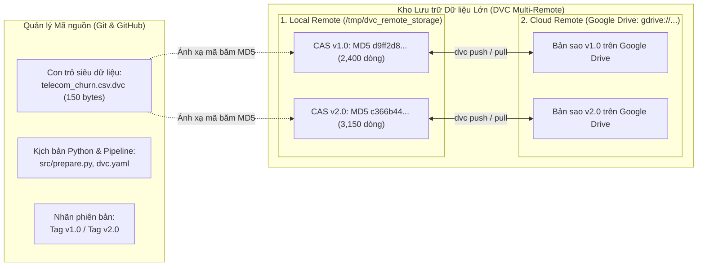

# Hướng Dẫn Thực Hành Bài 5: Quản Lý Mã Nguồn và Dữ Liệu (Git & DVC)

**Khóa học:** MLOps & AI Engineer  
**Chủ đề 4.3:** CI/CD/CT cơ bản cho AI  
**Bài 5:** Quản lý mã nguồn và Dữ liệu  

---

## 1. Giới thiệu & Mục tiêu Thực hành

Trong các hệ thống AI phục vụ sản xuất thực tế tại doanh nghiệp viễn thông, mã nguồn phần mềm chỉ là một nửa phương trình học máy ($Model = Code + Data$). Dữ liệu cước và hành vi thuê bao liên tục biến động theo từng chu kỳ đối soát tháng. Nếu chỉ quản lý mã nguồn bằng Git truyền thống, kỹ sư sẽ hoàn toàn bất lực trước các tệp dữ liệu nhị phân dung lượng lớn (GB/TB), dẫn tới nguy cơ sụp đổ tính lặp lại (Reproducibility Crisis) và không thể truy nguyên nguồn gốc mô hình khi xảy ra sự cố nghiệp vụ.

Bài thực hành này trang bị cho kỹ sư kỹ thuật kỹ năng vận hành **Kiến trúc Quản trị Phối hợp Kép Git + DVC (Data Version Control)** trên bài toán **Dự đoán Thuê bao Rời mạng (Churn Prediction)**.

### Mục tiêu Cốt lõi Cần Đạt:
1. **Thiết lập Cấu trúc Phân nhánh Doanh nghiệp:** Khởi tạo kho mã nguồn Git tuân thủ quy trình chung (`main`, `develop`, `feature/churn-dvc-versioning`) và thiết lập cơ chế bảo vệ mã nguồn.
2. **Khởi tạo DVC & Kho Lưu trữ Phụ trợ (Remote Storage):** Tích hợp DVC vào kho Git, cấu hình linh hoạt Multi-Remote kết hợp giữa lưu trữ cục bộ (Local Remote Storage) và dịch vụ lưu trữ đám mây (Google Drive Remote qua giao thức `gdrive://`), tách biệt triệt để luồng mã nguồn và luồng lưu trữ nhị phân dung lượng lớn.
3. **Quản lý Phiên bản Dữ liệu bằng Con trỏ Siêu dữ liệu (`.dvc`):** Đóng băng phiên bản dữ liệu cơ sở tháng 10 (v1.0 - 2,400 thuê bao) và phiên bản mở rộng tháng 11 (v2.0 - 3,150 thuê bao), bảo đảm tuân thủ nghiêm ngặt quy định An toàn Thông tin (quy định ATTT: dữ liệu lớn không lọt vào Git).
4. **Vận hành Kỹ thuật "Du hành Thời gian" (Data Time-Travel):** Tái lập chính xác 100% trạng thái dữ liệu lịch sử trong quá khứ phục vụ thanh tra, kiểm toán mô hình chỉ với 2 lệnh `git checkout` và `dvc checkout`.
5. **Tự động hóa Đường ống Dữ liệu (DVC Pipeline):** Xây dựng và thực thi pipeline liên hoàn gồm các chặng `prepare` và `train_evaluate` qua tệp `dvc.yaml`, đo kiểm chất lượng và tự động nghiệm thu toàn diện với `check_lab.py`.

---

## 2. Kịch bản Nghiệp vụ & Dữ liệu Thực hành

### Bối cảnh Bài toán Churn Viễn thông:
Doanh nghiệp viễn thông triển khai mô hình học máy phát hiện sớm các thuê bao có nguy cơ rời mạng để kích hoạt chương trình chăm sóc khách hàng đặc biệt.
- **Tập dữ liệu Tháng 10 (Phiên bản v1.0):** Gồm 2,400 bản ghi thuê bao với 13 đặc trưng kỹ thuật cước (thất bại cuộc gọi, số lần khiếu nại, thời lượng gọi thoại, số lượng tin nhắn SMS, gói cước, giá trị khách hàng...). Dữ liệu được huấn luyện cho mô hình cơ sở v1.0 (AUC ~0.94).
- **Tập dữ liệu Tháng 11 (Phiên bản v2.0):** Bổ sung thêm 750 bản ghi thuê bao phát sinh mới trong kỳ cước tháng 11, nâng tổng quy mô lên 3,150 bản ghi. Kỹ sư cần lưu vết phiên bản mới mà không làm mất đi khả năng khôi phục phiên bản cũ.



---

## 3. Cấu trúc Thư mục Bộ Thực hành

```text
lab-5/
├── README.md                      # Cẩm nang hướng dẫn thực hành độc lập (Tệp này)
├── requirements.txt               # Danh mục thư viện Python (dvc, pandas, scikit-learn)
├── dvc.yaml                       # Khai báo Pipeline tự động hóa (prepare -> train_evaluate)
├── check_lab.py                   # Công cụ tự động thẩm định và nghiệm thu kỹ thuật
├── assets/                        # Sơ đồ và hình ảnh minh họa kiến trúc
│   ├── dvc-dual-remote-architecture.png
│   ├── git-artifact-pointer.png
│   └── git-branching-strategy.png
├── data/                          # Thư mục chứa dữ liệu
│   ├── telecom_churn.csv          # Tệp dữ liệu thô ban đầu (v1.0 - Tháng 10: 2,400 dòng)
│   └── raw_updates/               # Dữ liệu cập nhật kỳ tiếp theo
│       └── nov_batch.csv          # 750 bản ghi thuê bao mới tháng 11
└── src/                           # Mã nguồn kịch bản tiền xử lý và huấn luyện
    ├── prepare.py                 # Tiền xử lý, lọc nhiễu, chuẩn hóa đặc trưng cước
    ├── train_evaluate.py          # Huấn luyện mô hình Random Forest, xuất metrics.json
    └── update_dataset.py          # Script tiện ích hỗ trợ cập nhật dữ liệu v2.0
```

---

## 4. Chuẩn bị Môi trường Làm việc

Trước khi thao tác, hãy mở cửa sổ terminal tại đúng thư mục `lab-5` và kiểm tra các công cụ hệ thống:

```bash
# 1. Kiểm tra vị trí thư mục làm việc (phải kết thúc bằng lab-5)
pwd

# 2. Kiểm tra phiên bản Python (yêu cầu Python >= 3.10)
python3 --version

# 3. Kiểm tra công cụ Git (yêu cầu Git >= 2.30)
git --version

# 4. Kiểm tra công cụ DVC (yêu cầu DVC >= 3.0)
dvc --version

# 5. Cài đặt các thư viện Python bổ trợ nếu chưa có (DVC, plugin Google Drive, scikit-learn, pandas)
pip install -r requirements.txt
```

> [!NOTE]
> Để kết nối DVC với Google Drive, hệ sinh thái DVC yêu cầu gói driver `dvc-gdrive` (đã được khai báo trong `requirements.txt`). Kỹ sư có thể cài đặt độc lập bất kỳ lúc nào bằng lệnh: `pip install dvc-gdrive`. Gói này cho phép DVC giao tiếp với Google Drive qua giao thức `gdrive://` và cơ chế xác thực Google OAuth 2.0.

---

## 5. Quy trình Thực hành Từng bước

### Nhiệm vụ 1: Khởi tạo Git & Thiết lập DVC Remote Storage

**Mục đích:** Thiết lập cấu trúc phân nhánh theo quy trình chung và khởi tạo hệ sinh thái quản lý siêu dữ liệu DVC.

#### Bước 1.1: Khởi tạo kho Git và cấu hình định danh kỹ sư
```bash
# Khởi tạo Git repository với nhánh mặc định là main
git init -b main

# Thiết lập danh tính kỹ sư thực hiện (thay bằng tên và email của học viên)
git config user.name "Nguyen Van A"
git config user.email "anv@example.com"

# Tạo commit cơ sở lưu cấu trúc ban đầu của dự án
git add README.md requirements.txt check_lab.py src/ assets/ dvc.yaml
git commit -m "chore: initial project repository structure"
```

#### Bước 1.2: Thiết lập cấu trúc nhánh theo quy trình chung
Tuân thủ quy trình phân nhánh chung: Nhánh `main` dành cho bản phát hành sản xuất, nhánh `develop` dành cho tích hợp kiểm thử, và nhánh `feature/*` dành cho phát triển tính năng mới.
```bash
# Tạo nhánh tích hợp develop và nhánh tính năng
git checkout -b develop
git checkout -b feature/churn-dvc-versioning
```

#### Bước 1.3: Khởi tạo DVC trong dự án
```bash
# Khởi tạo DVC repository
dvc init
```
*Kết quả quan sát:* DVC tạo thư mục ẩn `.dvc/` (chứa cấu hình nội bộ) và tệp `.dvcignore`.

#### Bước 1.4: Cấu hình DVC Remote Storage Cục bộ (Local Remote - Mặc định)
Trong môi trường phát triển cục bộ và thẩm định tự động, ta cấu hình một thư mục ngoài workspace làm kho lưu trữ tập trung mặc định (`-d`):
```bash
# Tạo thư mục kho lưu trữ từ xa mô phỏng (bên ngoài thư mục làm việc)
mkdir -p /tmp/dvc_remote_storage

# Khai báo DVC remote mang tên 'dvc_remote' và đặt làm remote mặc định (-d)
dvc remote add -d dvc_remote /tmp/dvc_remote_storage
```

#### Bước 1.5: Cấu hình Mở rộng DVC Remote với Google Drive (Cloud Remote)
Bên cạnh lưu trữ cục bộ, trong môi trường làm việc nhóm phân tán hoặc triển khai liên phòng ban, kỹ sư cần chia sẻ dữ liệu qua hạ tầng đám mây. DVC hỗ trợ tích hợp trực tiếp với **Google Drive** qua giao thức `gdrive://<folder_id>`:

1. **Chuẩn bị Thư mục trên Google Drive:**
   - Truy cập Google Drive (cá nhân hoặc Shared Drive của dự án).
   - Tạo một thư mục mới dành riêng cho dự án, ví dụ: `dvc_churn_storage`.
   - Mở thư mục vừa tạo và sao chép **Folder ID** từ thanh địa chỉ trình duyệt:
     `https://drive.google.com/drive/folders/<GOOGLE_DRIVE_FOLDER_ID>`  
     *(Ví dụ: nếu URL là `drive.google.com/drive/folders/1A2b3C4d5E6f_G7h8I9jKlMnOpQrStUvW`, thì Folder ID là `1A2b3C4d5E6f_G7h8I9jKlMnOpQrStUvW`).*

2. **Khai báo Google Drive Remote trong DVC:**
   ```bash
   # Đảm bảo driver dvc-gdrive đã được cài đặt
   pip install dvc-gdrive

   # Khai báo remote đám mây mang tên 'gdrive_remote'
   # (Thay <GOOGLE_DRIVE_FOLDER_ID> bằng ID thư mục Google Drive thực tế của bạn)
   dvc remote add gdrive_remote gdrive://<GOOGLE_DRIVE_FOLDER_ID>
   ```

3. **Cơ chế Xác thực Google Drive (Authentication):**
   - **Xác thực qua Web OAuth (Mặc định cho máy cá nhân):** Ở lần đầu tiên thực hiện `dvc push -r gdrive_remote` hoặc `dvc pull -r gdrive_remote`, DVC sẽ in một liên kết xác thực Google OAuth ra terminal. Bạn chỉ cần mở liên kết trên trình duyệt, đăng nhập tài khoản Google và nhấn *Allow*. DVC sẽ tự động lưu token xác thực cục bộ trong `.dvc/tmp/` (thư mục này đã được DVC tự động đưa vào `.gitignore`, tuyệt đối không lo lộ lọt bí mật lên Git).
   - **Xác thực qua Service Account (Khuyến nghị cho Server / CI/CD Runner):** Nếu triển khai trên máy chủ không có giao diện đồ họa, bạn có thể sử dụng Google Cloud Service Account và cấu hình tệp khóa JSON:
     ```bash
     dvc remote modify gdrive_remote gdrive_use_service_account true
     dvc remote modify gdrive_remote gdrive_service_account_json_file_path /duong/dan/service_account.json
     ```

#### Bước 1.6: Đóng băng cấu hình khởi tạo vào Git
```bash
# Đưa các tệp cấu hình DVC vào theo dõi của Git
git add .dvc .dvcignore
git commit -m "chore: initialize Git branches and DVC with local and Google Drive remotes"
```

> [!TIP]
> **Checkpoint 1:** Kiểm tra trạng thái Git và danh sách DVC Remote bằng các lệnh:
> ```bash
> git status
> dvc remote list
> ```
> *Kỳ vọng:* `git status` thông báo `working tree clean`, `dvc remote list` hiển thị đầy đủ cả remote cục bộ mặc định và remote Google Drive:
> ```text
> dvc_remote	/tmp/dvc_remote_storage (default)
> gdrive_remote	gdrive://<GOOGLE_DRIVE_FOLDER_ID>
> ```

---

### Nhiệm vụ 2: Quản lý Phiên bản Dữ liệu v1.0 (Tháng 10) & Hàng rào ATTT

**Mục đích:** Đóng băng tập dữ liệu thô tháng 10 bằng DVC, sinh tệp con trỏ siêu dữ liệu `.dvc` và kích hoạt hàng rào bảo vệ an toàn thông tin.

#### Bước 2.1: Khảo sát dữ liệu thô ban đầu
Tệp `data/telecom_churn.csv` chứa 2,400 bản ghi thuê bao tháng 10:
```bash
# Kiểm tra số dòng (2,401 dòng gồm cả dòng tiêu đề)
wc -l data/telecom_churn.csv

# Xem nhanh 5 bản ghi đầu tiên
head -n 5 data/telecom_churn.csv
```

#### Bước 2.2: Đưa dữ liệu thô vào quản lý của DVC
```bash
# Đóng băng tệp dữ liệu với DVC
dvc add data/telecom_churn.csv
```
*Hiện tượng quan sát được:*
1. DVC tính toán mã băm MD5 của tệp (`d9ff2d8919ff9265e9939a885cb14650`) và lưu bản sao vật lý vào kho đệm nội bộ `.dvc/cache/`.
2. DVC tự động sinh tệp con trỏ siêu dữ liệu `data/telecom_churn.csv.dvc`.
3. DVC tự động cập nhật `data/.gitignore` chứa tên `telecom_churn.csv`.

#### Bước 2.3: Thẩm định Tệp Con trỏ và Quy định ATTT
Mở tệp con trỏ siêu dữ liệu để kiểm tra nội dung:
```bash
cat data/telecom_churn.csv.dvc
```
*Cấu trúc hiển thị kỳ vọng:*
```yaml
outs:
- md5: d9ff2d8919ff9265e9939a885cb14650
  size: 98322
  path: telecom_churn.csv
```

Kiểm tra hàng rào ATTT bảo vệ kho Git:
```bash
# Xem nội dung .gitignore do DVC tạo ra
cat data/.gitignore

# Xác nhận Git hoàn toàn KHÔNG theo dõi tệp CSV dung lượng lớn
git status
```
*Giải thích:* Git chỉ nhìn thấy 2 tệp văn bản siêu nhẹ: `data/telecom_churn.csv.dvc` và `data/.gitignore`. Tệp CSV thô hoàn toàn bị ẩn khỏi Git, ngăn ngừa nguy cơ phình to kho mã nguồn và rò rỉ dữ liệu viễn thông.

#### Bước 2.4: Đẩy dữ liệu lên DVC Remote Storage & Gắn nhãn Git v1.0
```bash
# 1. Đẩy tệp dữ liệu thật vào kho lưu trữ từ xa cục bộ (mặc định)
dvc push

# 2. (Tùy chọn) Đẩy dữ liệu lên kho đám mây Google Drive để chia sẻ với đồng đội
# dvc push -r gdrive_remote

# Commit con trỏ siêu dữ liệu và các tệp mã nguồn vào Git
git add .
git commit -m "feat: track baseline churn dataset v1.0 (Oct 2026)"

# Gắn nhãn phiên bản v1.0
git tag -a v1.0 -m "Release Churn Dataset v1.0 - Baseline October (2,400 records)"
```

> [!TIP]
> **Checkpoint 2:** Kiểm tra kho lưu trữ từ xa:
> ```bash
> # Kiểm tra dữ liệu tại kho lưu trữ cục bộ:
> ls -la /tmp/dvc_remote_storage/files/md5/d9/
> ```
> *Kỳ vọng:* Xuất hiện tệp nhị phân có tên chính là chuỗi 30 ký tự còn lại của mã băm MD5. Nếu đã chạy đẩy lên Google Drive (`dvc push -r gdrive_remote`), bạn cũng sẽ thấy thư mục băm `d9` và tệp dữ liệu tương ứng xuất hiện trên giao diện web của Google Drive!

---

### Nhiệm vụ 3: Cập nhật Dữ liệu v2.0 (Tháng 11) & Quản lý Đa phiên bản

**Mục đích:** Mô phỏng chu kỳ cập nhật dữ liệu hàng tháng, nâng cấp quy mô tập dữ liệu lên 3,150 bản ghi và quản lý song song hai thế hệ dữ liệu.

#### Bước 3.1: Nạp đợt dữ liệu mới tháng 11
Sử dụng script tiện ích có sẵn để nối 750 bản ghi thuê bao mới từ `data/raw_updates/nov_batch.csv` vào `data/telecom_churn.csv`:
```bash
python3 src/update_dataset.py
```
*Hoặc thực hiện bằng lệnh bash tương đương:*
```bash
cat data/raw_updates/nov_batch.csv >> data/telecom_churn.csv
```

Kiểm tra số dòng mới:
```bash
wc -l data/telecom_churn.csv
# Kỳ vọng: 3,151 dòng (3,150 bản ghi dữ liệu + 1 dòng tiêu đề)
```

#### Bước 3.2: Đóng băng Phiên bản Dữ liệu mới với DVC
```bash
# DVC sẽ phát hiện nội dung tệp thay đổi và tính mã băm MD5 mới
dvc add data/telecom_churn.csv
```
*Hiện tượng:* DVC tính toán mã băm mới (`c366b44c73b3338485a2cb311635175d`) và cập nhật lại nội dung tệp con trỏ `data/telecom_churn.csv.dvc`.

Kiểm tra mã băm mới:
```bash
cat data/telecom_churn.csv.dvc
```

#### Bước 3.3: Đồng bộ lên Remote Storage & Gắn nhãn Git v2.0
```bash
# 1. Đẩy phiên bản dữ liệu mới lên kho lưu trữ DVC Remote mặc định
dvc push

# 2. (Tùy chọn) Đồng bộ phiên bản v2.0 lên Google Drive Remote
# dvc push -r gdrive_remote

# Cam kết con trỏ mới vào Git
git add data/telecom_churn.csv.dvc
git commit -m "feat: update churn dataset to v2.0 (Nov 2026 - 3,150 subscribers)"

# Gắn nhãn phiên bản v2.0
git tag -a v2.0 -m "Release Churn Dataset v2.0 - Expanded November (3,150 records)"
```

> [!TIP]
> **Checkpoint 3:** Kiểm tra lịch sử commit và tag của Git:
> ```bash
> git tag -l -n1
> git log --oneline -n 3
> ```
> *Kỳ vọng:* Hiển thị rõ ràng 2 nhãn `v1.0` và `v2.0` tương ứng với hai lần cập nhật con trỏ DVC.

---

### Nhiệm vụ 4: Kiểm chứng Kỹ thuật "Data Time-Travel"

**Mục đích:** Tái lập chính xác trạng thái dữ liệu quá khứ trong chớp mắt khi có yêu cầu kiểm toán hoặc đối soát từ Ban Nghiệp vụ.

#### Tình huống Thực tiễn:
*Ban Kiểm toán yêu cầu: "Hệ thống cần chạy lại và đối soát độ chính xác của mô hình Churn v1.0 được công bố hồi tháng 10. Hãy khôi phục đúng tập dữ liệu gốc 2,400 thuê bao ngày ấy."*

#### Bước 4.1: Bước 1 của Time-Travel — Chuyển trạng thái Git về Tag `v1.0`
```bash
# Tua lại mã nguồn và con trỏ siêu dữ liệu về thời điểm gắn tag v1.0
git checkout v1.0
```
Quan sát nội dung con trỏ siêu dữ liệu:
```bash
cat data/telecom_churn.csv.dvc
# Quan sát: Mã băm lập tức quay trở lại: d9ff2d8919ff9265e9939a885cb14650
```

#### Bước 4.2: Bước 2 của Time-Travel — Đồng bộ tệp dữ liệu thật với DVC
```bash
# Ra lệnh cho DVC hoán đổi tệp dữ liệu vật lý theo con trỏ hiện tại
dvc checkout data/telecom_churn.csv
```

Kiểm tra số dòng và tính toàn vẹn của tệp:
```bash
wc -l data/telecom_churn.csv
# Kết quả kỳ vọng: Chính xác 2,401 dòng (đã khôi phục hoàn hảo về trạng thái tháng 10!)
```

#### Bước 4.3: Quay trở lại Hiện tại (Phiên bản v2.0)
Sau khi đối soát xong, kỹ sư dễ dàng đưa không gian làm việc trở lại nhánh phát triển:
```bash
# Chuyển Git về lại nhánh làm việc
git checkout feature/churn-dvc-versioning

# Đồng bộ lại dữ liệu thật của tháng 11
dvc checkout data/telecom_churn.csv

# Kiểm tra lại số dòng
wc -l data/telecom_churn.csv
# Kết quả kỳ vọng: Đã quay trở lại 3,151 dòng (v2.0)!
```

> [!TIP]
> **Checkpoint 4:** Khả năng Data Time-Travel hoạt động hoàn hảo mà không cần phải sao chép thủ công các tệp dữ liệu `_backup.csv` hay `_v1_final_final.csv`!

---

### Nhiệm vụ 5: Tự động hóa Pipeline Dữ liệu (`dvc.yaml`) & Nghiệm thu

**Mục đích:** Xây dựng đường ống tự động liên kết từ tiền xử lý dữ liệu đến huấn luyện mô hình, tự động phát hiện thay đổi và nghiệm thu toàn diện bài lab.

#### Bước 5.1: Khảo sát tệp định nghĩa Pipeline `dvc.yaml`
Mở và khảo sát tệp `dvc.yaml` đã được thiết kế sẵn:
```yaml
stages:
  prepare:
    cmd: python3 src/prepare.py
    deps:
      - data/telecom_churn.csv
      - src/prepare.py
    outs:
      - data/churn_features.csv

  train_evaluate:
    cmd: python3 src/train_evaluate.py
    deps:
      - data/churn_features.csv
      - src/train_evaluate.py
    outs:
      - models/churn_model.pkl
    metrics:
      - metrics.json:
          cache: false
```
*Ý nghĩa kiến trúc:*
- Stage `prepare`: Lấy dữ liệu thô `telecom_churn.csv` làm đầu vào (`deps`), lọc nhiễu và trích xuất đặc trưng ra `data/churn_features.csv` (`outs`).
- Stage `train_evaluate`: Lấy dữ liệu đặc trưng làm đầu vào, huấn luyện mô hình Random Forest, lưu mô hình `models/churn_model.pkl` và xuất chỉ số kiểm định ra `metrics.json`.

#### Bước 5.2: Thực thi Pipeline bằng `dvc repro`
```bash
# Chạy quy trình tái tạo tự động
dvc repro
```
*Hiện tượng quan sát được:*
1. DVC tuần tự chạy lệnh `python3 src/prepare.py` và `python3 src/train_evaluate.py`.
2. DVC tự động sinh tệp khóa `dvc.lock` ghi lại chữ ký MD5 của toàn bộ mã nguồn, dữ liệu đầu vào và sản phẩm đầu ra.
3. Sinh tệp `metrics.json` chứa các chỉ số Accuracy, Recall, ROC-AUC.

Xem kết quả đánh giá mô hình:
```bash
cat metrics.json
```

#### Bước 5.3: Thử nghiệm Tính năng Bỏ qua Thông minh (Smart Caching)
Chạy lại lệnh `dvc repro` thêm một lần nữa:
```bash
dvc repro
```
*Kết quả:* DVC thông báo `Stage 'prepare' didn't change, skipping` và `Data and pipelines are up to date`. DVC nhận diện không có bất kỳ byte dữ liệu hay mã nguồn nào thay đổi, do đó tiết kiệm 100% tài nguyên tính toán!

#### Bước 5.4: Cam kết Sản phẩm Pipeline vào Git
```bash
# Thêm tệp khóa dvc.lock và chỉ số metrics vào Git
git add dvc.lock metrics.json data/.gitignore models/
git commit -m "feat: automate data preprocessing and training pipeline with dvc.yaml"
```

#### Bước 5.5: Hợp nhất vào nhánh `develop` (Giả lập Pull Request)
```bash
# Chuyển sang nhánh develop và gộp tính năng
git checkout develop
git merge feature/churn-dvc-versioning
```

#### Bước 5.6: Tự động Thẩm định & Nghiệm thu Toàn diện (`check_lab.py`)
Chạy công cụ kiểm tra tự động để xác nhận toàn bộ 6 tiêu chí kỹ thuật:
```bash
python3 check_lab.py
```

*Kết quả kỳ vọng:*
```text
====================================================================
  TỔNG HỢP KẾT QUẢ NGHIỆM THU KỸ THUẬT
====================================================================

  [ĐẠT] Git Repository & Identity           : Git đã sẵn sàng (Nhánh: develop)
  [ĐẠT] DVC Setup & Remote Storage          : DVC và Remote Storage đã sẵn sàng.
  [ĐẠT] Metadata Pointer & ATTT Compliance  : Hệ thống con trỏ và hàng rào ATTT hoàn hảo.
  [ĐẠT] Version Tags & Releases             : Tìm thấy các nhãn phiên bản: v1.0, v2.0
  [ĐẠT] Data Integrity & Time-Travel        : Dữ liệu khớp chuẩn phiên bản v2.0
  [ĐẠT] Pipeline & Metrics Verification     : Pipeline và số liệu kiểm thử đạt yêu cầu.

Kết quả chung: 6/6 tiêu chí nghiệm thu hoàn thành.

>>> XUẤT SẮC! HỌC VIÊN ĐÃ HOÀN THÀNH TOÀN DIỆN MỤC TIÊU BÀI LAB 8 <<<
```

---

## 6. Bảng Tra Cứu Nhanh Lệnh Phối Hợp Git + DVC

| Thao tác Quản trị | Lệnh Git (Code & Metadata) | Lệnh DVC (Dữ liệu Lớn) | Ý nghĩa Vận hành |
| :--- | :--- | :--- | :--- |
| **Khởi tạo dự án** | `git init -b main` | `dvc init` | Tạo kho theo dõi mã nguồn và kho siêu dữ liệu DVC. |
| **Thiết lập Remote Cục bộ** | `git remote add origin <url>` | `dvc remote add -d <name> <path>` | Thiết lập máy chủ GitHub và kho lưu trữ cục bộ mặc định. |
| **Thiết lập Remote Google Drive** | — | `dvc remote add <name> gdrive://<id>` | Thiết lập kho lưu trữ đám mây Google Drive để chia sẻ nhóm. |
| **Đóng băng dữ liệu mới** | `git add data.csv.dvc .gitignore` | `dvc add data.csv` | DVC lưu dữ liệu vào CAS; Git chỉ lưu con trỏ siêu dữ liệu nhẹ 150 bytes. |
| **Đồng bộ lên máy chủ** | `git push origin <branch>` | `dvc push` (hoặc `-r gdrive_remote`) | Đẩy mã nguồn lên GitHub; đẩy tệp dữ liệu lớn lên Local Remote hoặc Google Drive. |
| **Tải dự án về máy mới** | `git clone <url>` | `dvc pull` (hoặc `-r gdrive_remote`) | Kéo mã nguồn từ GitHub; sau đó kéo dữ liệu thật về đĩa cứng từ Local/Google Drive. |
| **Tua lại thời gian (Time-Travel)** | `git checkout <tag/commit>` | `dvc checkout data/telecom_churn.csv` | Git tua lại con trỏ `.dvc`; DVC lập tức hoán đổi tệp dữ liệu khớp mã băm. |
| **Tự động hóa đường ống** | `git add dvc.yaml dvc.lock` | `dvc repro` | Thực thi các chặng pipeline và lưu vết trạng thái phụ thuộc vào `dvc.lock`. |

---

## 7. Bảng Xử Lý Sự Cố Thường Gặp (Troubleshooting)

| Dấu hiệu Lỗi | Nguyên nhân Kỹ thuật | Cách Kiểm tra | Giải pháp Khắc phục |
| :--- | :--- | :--- | :--- |
| **`dvc add` báo lỗi: "is not inside a git repository"** | Chưa chạy lệnh `git init` trước khi khởi tạo DVC. | Kiểm tra thư mục ẩn `.git` bằng lệnh `ls -la`. | Chạy `git init -b main` rồi thử lại `dvc init`. |
| **`dvc push` báo lỗi: "No remote repository specified"** | Chưa thiết lập DVC Remote hoặc chưa đặt tham số `-d` (default). | Chạy `dvc remote list`. | Thêm remote mặc định: `dvc remote add -d dvc_remote /tmp/dvc_remote_storage`. |
| **`git status` vẫn thấy tệp CSV 50MB xuất hiện trong Git** | Tệp CSV đã bị `git add` vào Git index trước khi chạy `dvc add`. | Chạy `git ls-files data/telecom_churn.csv`. | Gỡ khỏi Git index nhưng giữ lại trên đĩa: `git rm --cached data/telecom_churn.csv`, sau đó chạy lại `dvc add`. |
| **`dvc checkout` báo lỗi: "data not found in cache"** | Dữ liệu phiên bản cũ chưa được tải về hoặc bị xóa khỏi local cache. | Kiểm tra thư mục `.dvc/cache/files/md5/`. | Chạy `dvc pull` để kéo bản sao tương ứng từ DVC Remote Storage về cache. |
| **`check_lab.py` báo thiếu Git Tag `v1.0` hoặc `v2.0`** | Quên chưa gắn nhãn phiên bản sau khi commit con trỏ DVC. | Chạy `git tag -l`. | Gắn lại nhãn: `git tag -a v1.0 -m "Release v1.0"` tại commit tương ứng. |
| **`dvc repro` báo lỗi: "Stage 'prepare' failed"** | Thiếu file dữ liệu `data/telecom_churn.csv` hoặc sai đường dẫn. | Kiểm tra file bằng `ls -la data/telecom_churn.csv`. | Chạy `dvc checkout` để DVC phục hồi dữ liệu thật trước khi chạy pipeline. |
| **`dvc push/pull` báo lỗi: "URL 'gdrive://...' is not supported"** | Chưa cài đặt thư viện driver `dvc-gdrive`. | Kiểm tra danh sách thư viện bằng `pip list \| grep dvc`. | Cài đặt driver: `pip install dvc-gdrive`. |
| **Lỗi xác thực Google Drive (OAuth Timeout / Permission Denied)** | Token OAuth hết hạn hoặc tài khoản Google chưa được cấp quyền trên thư mục. | Kiểm tra thư mục `.dvc/tmp/` hoặc quyền truy cập Google Drive. | Xóa token cũ trong `.dvc/tmp/` để đăng nhập lại OAuth, hoặc kiểm tra quyền chia sẻ (Share) của thư mục trên Google Drive. |

---

## 8. Hướng Dẫn Tẩy Trạng Thái & Thực Hiện Lại (Reset Lab)

Nếu học viên muốn thực hành lại toàn bộ quy trình từ đầu:
```bash
# 1. Xóa thư mục quản trị Git và DVC
rm -rf .git .dvc .dvcignore dvc.lock metrics.json models/

# 2. Xóa các con trỏ DVC đã sinh ra
rm -f data/telecom_churn.csv.dvc data/churn_features.csv data/.gitignore

# 3. Phục hồi lại dữ liệu ban đầu tháng 10 (2,400 bản ghi)
head -n 2401 data/telecom_churn.csv > /tmp/churn_v1.csv
mv /tmp/churn_v1.csv data/telecom_churn.csv

# 4. Xóa kho lưu trữ từ xa thử nghiệm
rm -rf /tmp/dvc_remote_storage

# 5. Sẵn sàng bắt đầu lại từ Nhiệm vụ 1!
```
